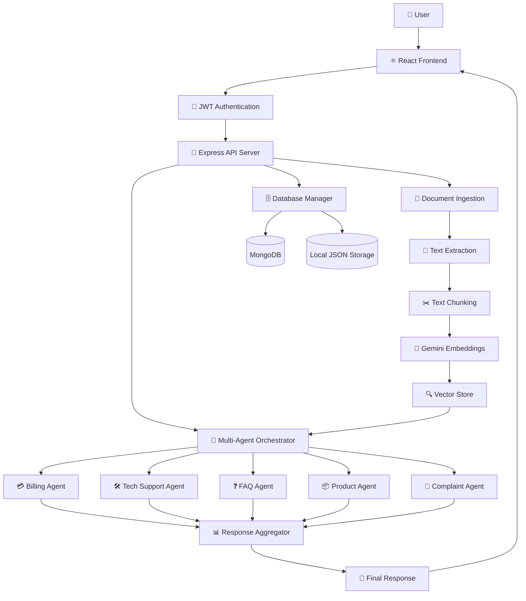
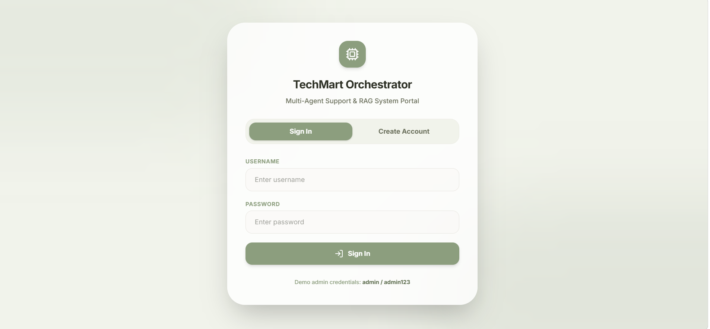
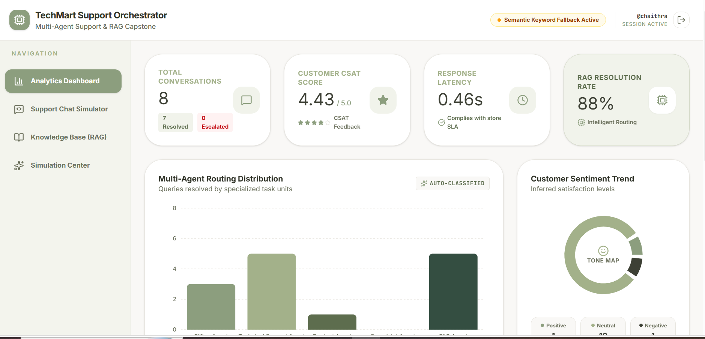
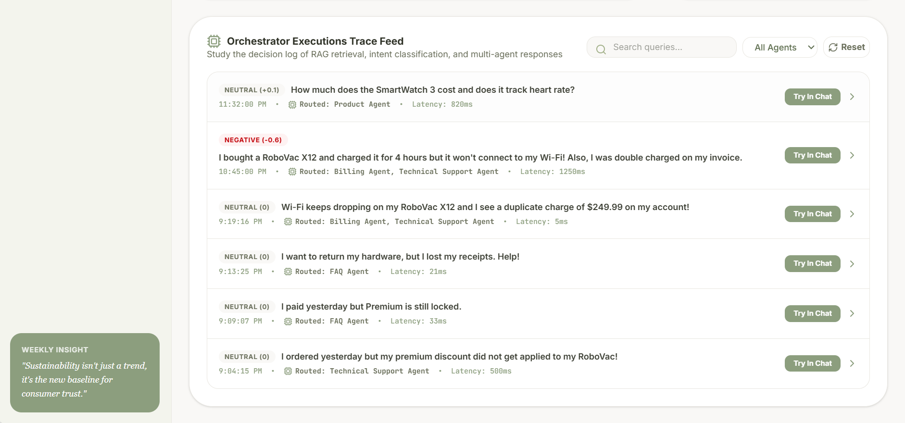
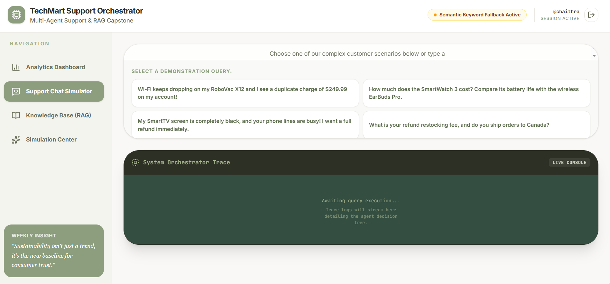
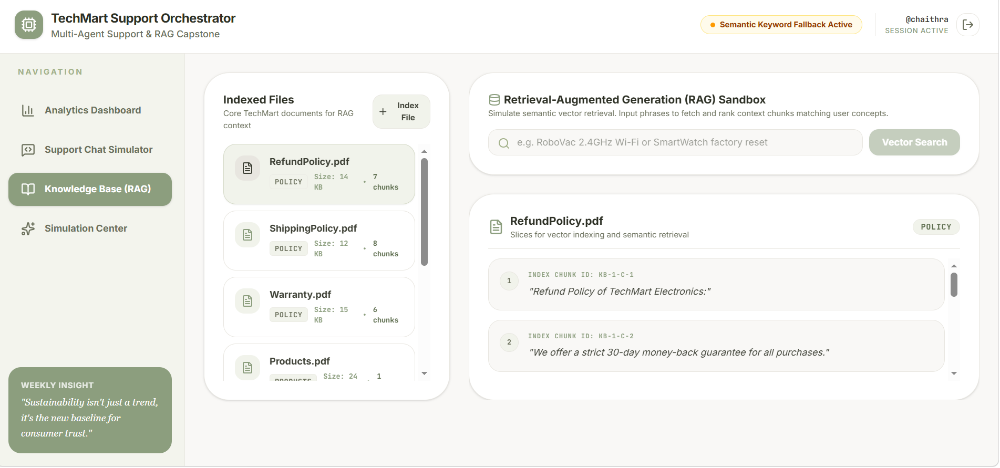
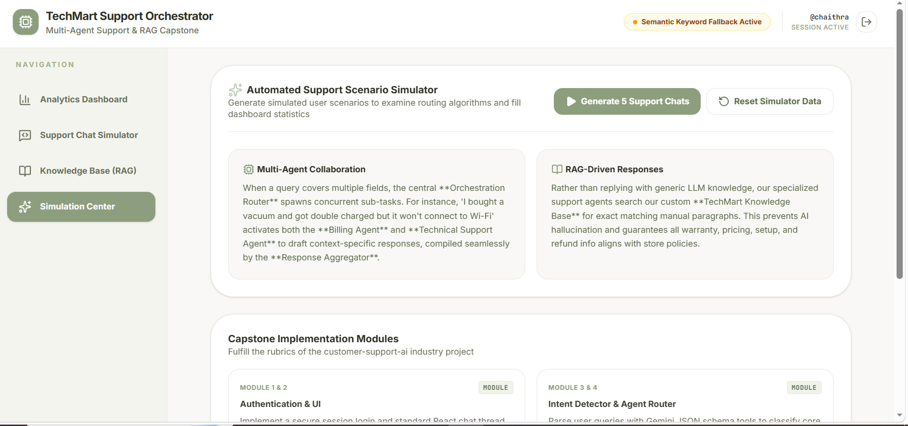

# 🤖 Multi-Agent Customer Support Assistant using RAG

An AI-powered customer support assistant built using **Retrieval-Augmented Generation (RAG), Gemini AI, Node.js, Express, React, TypeScript, and MongoDB**.

The application uses a multi-agent architecture to automatically classify incoming customer queries, retrieve relevant knowledge, route requests to specialized agents, and generate contextual responses.

It combines semantic vector search, document ingestion, AI orchestration, and persistent conversation management to create an intelligent customer support experience.

---

## ✨ Key Features

- 🤖 **Multi-Agent AI Orchestration:** Dynamically routes customer queries to specialized Billing, Tech Support, FAQ, Product, and Complaint agents.
- 📚 **RAG-Based Knowledge Retrieval:** Retrieves relevant information from uploaded knowledge documents before generating responses.
- 📄 **PDF & TXT Ingestion:** Uploads and processes PDF and TXT documents using Multer and pdf-parse.
- 🔍 **Semantic Vector Search:** Uses cosine similarity to identify relevant document chunks.
- 🧠 **Gemini Embeddings:** Generates document embeddings using Google's `text-embedding-004` model.
- 🗄️ **MongoDB Integration:** Uses MongoDB and Mongoose to store users, knowledge documents, chunks, and conversation histories.
- 🔄 **Local JSON Fallback:** Provides local JSON-file storage when MongoDB is unavailable.
- 🔐 **JWT Authentication:** Provides registration, login, and protected API endpoints.
- ⚙️ **Fallback Rule Engine:** Supports keyword-based classification and semantic scoring when Gemini is unavailable.
- 📊 **Analytics Dashboard:** Displays customer satisfaction scores, sentiment trends, and agent distribution.
- ⭐ **Customer Feedback:** Supports customer satisfaction ratings for conversations.

---

## 🛠️ Technologies & Tools Used

| Technology | Purpose |
|---|---|
| ⚛️ React | Frontend user interface |
| 📘 TypeScript | Type-safe development |
| ⚡ Vite | Frontend development tooling |
| 🟢 Node.js | Backend runtime |
| 🚀 Express.js | REST API development |
| 🧠 Google Gemini | AI orchestration and generation |
| 🔍 RAG | Context-aware knowledge retrieval |
| 📐 Cosine Similarity | Semantic vector matching |
| 🗄️ MongoDB | Persistent database |
| 🔗 Mongoose | MongoDB object modeling |
| 🔐 JWT | Authentication |
| 🐳 Docker | Containerization |
| 🧪 Node.js Test Runner | Automated testing |

---

## 🏗️ System Architecture

The application follows a multi-layer architecture consisting of a frontend, backend API, authentication middleware, knowledge retrieval system, database manager, and multi-agent orchestration pipeline.

### 🔹 Architecture Workflow



### 🔹 Core Architecture Components

**1. Frontend Layer**
- React-based user interface.
- Vite development environment.
- HTTP communication with backend APIs.

**2. Backend Layer**
- Express REST API.
- JWT authentication middleware.
- File upload and document processing.

**3. Knowledge Retrieval Layer**
- PDF and TXT text extraction.
- Document chunking.
- Gemini embedding generation.
- Cosine similarity-based retrieval.

**4. Multi-Agent Layer**
- Query classification and routing.
- Specialized customer support agents.
- Response aggregation and synthesis.
- Rule-based fallback mechanism.

**5. Database Layer**
- MongoDB with Mongoose.
- Local JSON-file fallback storage.

---

## 📡 REST API Documentation

### 🌐 Public Endpoints

| Method | Endpoint | Description |
|---|---|---|
| GET | `/api/health` | Check application health and Gemini status |
| POST | `/api/auth/register` | Register a new user |
| POST | `/api/auth/login` | Authenticate a user and issue a JWT |

### 🔐 Protected Endpoints

These endpoints require an authorization header:

```text
Authorization: Bearer <JWT_TOKEN>
```

| Method | Endpoint | Description |
|---|---|---|
| GET | `/api/knowledge-base` | Retrieve knowledge documents and chunk samples |
| POST | `/api/knowledge-base/upload` | Upload raw text content |
| POST | `/api/knowledge-base/upload-file` | Upload PDF/TXT documents |
| POST | `/api/knowledge-base/search` | Search the vector database |
| GET | `/api/analytics` | Retrieve analytics and metrics |
| POST | `/api/chat` | Process queries through RAG and agent orchestration |
| POST | `/api/chat/feedback` | Submit customer satisfaction ratings |
| POST | `/api/simulation/run` | Generate simulated conversations |
| POST | `/api/simulation/reset` | Reset conversation history |

---

## ⚡ Installation & Setup

### 📌 Prerequisites

Make sure you have installed:

- Node.js (v18 or later)
- npm
- Git
- Docker and Docker Compose (optional)
- MongoDB (optional if using local JSON fallback)
- Google Gemini API key

### 1️⃣ Clone the Repository

```bash
git clone https://github.com/chaithranarendrabhandarkar2004/MULTI_AGENT.git

cd MULTI_AGENT
```

### 2️⃣ Install Dependencies

```bash
npm install
```

### 3️⃣ Configure Environment Variables

Create a `.env` file in the project root:

```env
GEMINI_API_KEY=your_gemini_api_key
MONGO_URI=mongodb://localhost:27017/support_rag
JWT_SECRET=your_secure_random_secret
```

**Important:** Replace the example values with your own configuration. Never upload your actual `.env` file or API keys to GitHub.

### 4️⃣ Start the Development Server

```bash
npm run dev
```

Open the application in your browser:

```text
http://localhost:3000
```

---

## 🐳 Running with Docker Compose

The project also supports containerized execution using Docker Compose.

### 1️⃣ Configure Environment Variables

Make sure your `.env` file contains the required configuration.

### 2️⃣ Build and Start Containers

```bash
docker-compose up --build
```

This builds the application container and starts the associated MongoDB service with persistent volume storage.

### 3️⃣ Access the Application

Open:

```text
http://localhost:3000
```

---

## 🧪 Running Automated Tests

Run the automated test suite using:

```bash
npm run test
```

The tests cover:

- 📐 Cosine similarity calculations.
- 🔐 Bcrypt password hashing and validation.
- 🎫 JWT token creation and tampering checks.
- 🗄️ Database adapter connectivity and fallback behavior.

---

## 🔒 Security Considerations

- Store API keys and secrets in environment variables.
- Never commit `.env` files to GitHub.
- Use strong, unique JWT secrets.
- Change or remove any default development administrator credentials before deployment.
- Use HTTPS and appropriate access controls in production.
- Validate uploaded files and enforce suitable upload limits.

---

## ⚠️ Limitations

- AI-generated responses may contain inaccurate information.
- Retrieval quality depends on the quality and relevance of uploaded documents.
- Gemini functionality depends on API availability and quota limits.
- Local JSON fallback is intended for development and should be evaluated before production use.
- Customer support responses should be reviewed appropriately before being used for important decisions.

---

## 🔮 Future Improvements

- 📈 Improve agent routing and response evaluation.
- 🧠 Explore advanced retrieval and reranking techniques.
- 🔍 Add more detailed RAG evaluation metrics.
- 💬 Improve conversation memory and contextual follow-ups.
- 📊 Enhance analytics and reporting.
- 🔐 Strengthen production authentication and authorization.
- 🚀 Improve deployment and scalability.

---

## 👨‍💻 Author

**Chaithra Narendra Bhandarkar**

🐙 GitHub: [@chaithranarendrabhandarkar2004](https://github.com/chaithranarendrabhandarkar2004)

## 📸 Project Screenshots

Explore the different sections of the Multi-Agent Customer Support Assistant.

### 🔐 Sign In Page
[](screenshots/signin.png)

### 📊 Analytics Dashboard
[](screenshots/analytics.png)

[](screenshots/analytics1.png)

### 💬 Support Chat Simulator
[](screenshots/support-chat.png)

### 📚 Knowledge Base
[](screenshots/knowledge-base.png)

### 🧪 Simulation Center
[](screenshots/simulation-center.png)

*Click any screenshot to view it in full size.*

---

⭐ If you find this project interesting, consider giving the repository a star!

**Built with ❤️ using AI, RAG, and Multi-Agent Architecture.**
